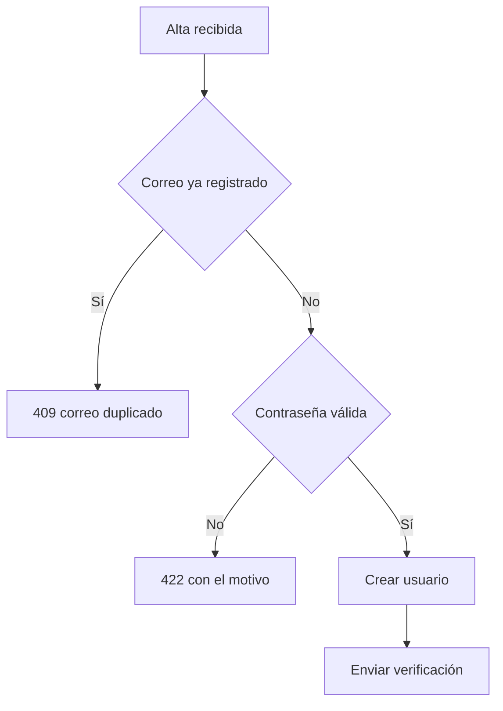

# Diagramas (cuándo dibujar, cuánto y en qué formato)

Un diagrama que acierta ahorra tres párrafos. Uno que no, cuesta el rato de hacerlo, el rato de
descifrarlo y el descubrimiento, dos meses después, de que ya no dice la verdad. Esta guía
decide las tres cosas que se fallan siempre: **si se dibuja, cuánto puede crecer y en qué
formato va según dónde acabe**.

**Cuándo:** al preparar la prueba visual del cuerpo de una PR, al documentar una decisión
técnica en el repo, al explicar un flujo que nadie tiene entero en la cabeza. Y en cuanto te
pilles abriendo una herramienta de dibujo antes de haber escrito la frase que el diagrama
sustituiría.

## El gate de entrada

Una pregunta antes de nada:

> **¿Aprendería el lector más de este diagrama que de un párrafo bien escrito o de una tabla de
> tres columnas?**

Si la respuesta es no, no se dibuja. No es una preferencia estética: un diagrama de más obliga
a leer dos veces lo mismo y no añade nada.

Casos donde la respuesta es no casi siempre:

| Lo que ibas a dibujar | Lo que toca |
|---|---|
| Una lista de cosas (componentes, pasos, opciones) | Tabla o viñetas |
| Un antes / después | Tabla de dos columnas |
| Un diagrama de una sola caja | Escribe la frase |
| Lo que el texto de al lado ya explica entero | Nada |

Y un gate más, que es el que produce diagramas que mienten: **un diagrama afirma cosas**. Cada
caja y cada flecha es una aseveración sobre cómo funciona el sistema. No dibujes lo que no has
comprobado en el código, con la disciplina de {{guide:evidencia-y-preguntas}}; lo que supongas,
márcalo como supuesto en el pie.

## Presupuesto de complejidad

Por diagrama:

| Límite | Máximo |
|---|---|
| Nodos | 9 |
| Flechas o transiciones | 12 |
| Elementos destacados | 2 |

Si te pasas, **no aprietas el diagrama: lo partes en dos** — uno de visión general y otro de
detalle. Encoger la letra, juntar cajas o cruzar flechas para que quepa todo no es resolver el
problema; es esconderlo.

El motivo del techo: lo único que justifica dibujar es que **se lea de un vistazo**. Por encima
de ese tamaño deja de leerse de un vistazo, y entonces el diagrama ya no gana nada frente al
párrafo que sustituía. El presupuesto no es una regla de estilo, es el punto donde el diagrama
deja de ser rentable.

Lo mismo con los dos elementos destacados. Destacar es decir «mira esto primero». Si destacas
seis, no has decidido cuál importa y el lector se queda igual.

## Declara antes de dibujar

Antes de gastar el esfuerzo, una línea: **qué tipo de diagrama vas a hacer y qué dejas fuera
por el presupuesto**.

> «Voy a hacer un `flowchart` del alta con los dos desvíos de validación. Dejo fuera el
> desglose del envío del correo y los reintentos, que no caben.»

Y espera. Si el usuario está delante, deja que te redirija: corregir esa frase cuesta segundos
y rehacer el diagrama no. Si no está, dibuja y anota al lado lo que asumiste y lo que recortaste
— eso va también a `progress.md` según {{guide:registro-progreso}}, porque «esto no está
dibujado» es información que se pierde entera si no se escribe. Sáltate la pausa solo cuando la
petición ya fije tipo y contenido.

## Regla de canal

El formato no lo eliges tú: lo elige **dónde va a acabar el diagrama**. Un SVG impecable que el
destino no pinta es un hueco en blanco. Es la regla que más se incumple y la que más cara sale,
porque el fallo no se ve hasta que lo lee otro.

| Destino | Formato |
|---|---|
| Cuerpo de PR, comentario de PR, fichero `.md` del repo | **Mermaid** en bloque cercado |
| Comentario de ClickUp | Captura **PNG** adjunta a la tarea y enlazada desde el comentario |
| Material de cliente, diapositivas, documentación publicada fuera de GitHub | **HTML/SVG** del plugin `diagram-design`, exportado a PNG si el destino no renderiza HTML |
| Explicación efímera en la conversación | **Texto**. No se dibuja |

Los motivos, que son lo que hace que la tabla no se te olvide:

- **GitHub renderiza Mermaid de forma nativa** en cuerpos de PR, comentarios y ficheros `.md`
  del repo.
- **GitHub sanea el HTML contra una lista blanca.** ``, `<picture>`, `<details>` y
  `<table>` sobreviven; **el `<svg>` inline se elimina entero** y deja el hueco. Un diagrama SVG
  solo se ve si está **commiteado en el repo**.
- **Y la ruta relativa no vale en todas partes.** `` solo se
  reescribe en ficheros `.md` del repo. En cuerpos de PR, issues y comentarios, GitHub deja el
  `src` tal cual, el navegador lo resuelve contra la URL de la página y sale 404: ahí toca
  `../blob/main/ruta/al/diagrama.svg?raw=true` o la URL absoluta de `raw.githubusercontent.com`.
- **ClickUp no renderiza ni HTML ni Mermaid.** Un bloque cercado se queda ahí como texto
  monoespaciado que nadie lee. Adjunta la captura a la tarea y enlázala desde el comentario.
- **En la conversación no se dibuja.** Una respuesta que se lee y se olvida no necesita
  acompañamiento visual; ese diagrama es trabajo que se tira en el mismo mensaje.

### `diagram-design` es opcional — detecta antes de prometerlo

Es un plugin **aparte** y **no es dependencia de este**. Antes de ofrecer HTML/SVG, comprueba
que lo tienes: `diagram-design` debe aparecer entre tus skills disponibles. Si no está:

1. **Degrada.** El canal de cliente y diapositivas baja a Mermaid, que sigue siendo mejor que
   nada, y lo dices en el entregable. El de ClickUp se queda sin PNG que producir: ahí baja a
   prosa o tabla en el comentario, con enlace a la PR donde el Mermaid sí se ve. No prometas un
   formato que no puedes producir.
2. **Informa de cómo instalarlo**, una vez y sin insistir:

   ```
   /plugin marketplace add https://github.com/cathrynlavery/diagram-design.git
   /plugin install diagram-design@diagram-design
   ```

   Usa la URL HTTPS: con el atajo `owner/repo`, Claude Code tiende a clonar por SSH y falla si
   no está la host key de GitHub en `known_hosts`. Si aun así clona por SSH, el propio error
   dicta el remedio — `ssh -T git@github.com` una vez, para registrar la host key.

Para **exportar a PNG** hace falta además `pip install playwright` y
`python -m playwright install chromium`. El export a SVG no lo necesita. Si vas a adjuntar una
captura a ClickUp y Playwright no está, dilo antes de empezar a dibujar, no después.

Y si el SVG acaba commiteado y mirado en GitHub, exporta PNG igualmente: GitHub sirve los
`.svg` con `Content-Security-Policy: default-src 'none'`, que bloquea las fuentes remotas que
el export inyecta. El diagrama se ve; la tipografía, no.

Y antes de dibujar nada para una PR: si el cambio tiene pantalla, la prueba visual son las
capturas que ya produjo {{guide:qa-exploratoria}}, no un diagrama. El diagrama es para lo que
**no tiene pantalla que capturar**.

## Qué tipo para qué

Los pocos que salen de verdad en el día a día del flujo:

| Lo que muestras | Tipo |
|---|---|
| Flujo de decisión con ramas | `flowchart` |
| Intercambio ordenado entre actores (petición, respuesta, orden en el tiempo) | `sequenceDiagram` |
| Ciclo de vida de una entidad, con esperas y estados terminales | `stateDiagram-v2` |
| Proceso con traspasos entre responsables | `flowchart` con un `subgraph` por responsable |
| Dependencias entre módulos | `flowchart` |

Para el último, las fronteras que dibujas son las de {{guide:arquitectura}}: si el diagrama
enseña una flecha que se salta una capa, eso no es un detalle del dibujo, es un hallazgo.

El caso más frecuente —flujo de decisión— entero y dentro de presupuesto (7 nodos, 6 flechas):



Fíjate en lo que no está: el envío del correo no se desglosa, los reintentos no aparecen y no
hay una caja por cada capa del código. Cabe de un vistazo porque se dejó fuera lo que no
decidía nada.

## Anti-patrones

- **Diagrama que repite el texto de al lado** — si el párrafo ya lo cuenta, el diagrama no
  informa: obliga a leer dos veces. Borra uno de los dos.
- **El sistema entero para una PR de tres ficheros** — el diagrama cubre lo que el cambio toca,
  no el mapa completo del repo. Dibujar de más entierra lo que querías enseñar.
- **Imagen pegada sin texto alternativo ni pie** — sin `alt` no existe para quien usa lector de
  pantalla, que es el criterio WCAG de {{guide:usabilidad-accesibilidad}}; y sin pie nadie sabe
  qué mira ni de cuándo es.
- **El diagrama que nadie actualiza** — dibujado en la PR, correcto ese día y mentiroso a los
  dos meses. Si no va a mantenerse, que sea Mermaid junto al código que describe, y si describe
  algo que cambia cada semana, no lo dibujes.
- **Seis cosas destacadas** — destacar todo es no destacar nada. Dos como mucho; si no sabes
  cuáles, es que aún no has decidido qué cuenta el diagrama.
- **Formato elegido por comodidad** — el SVG bonito en un comentario de GitHub y el bloque
  Mermaid en ClickUp son el mismo error: se eligió el formato sin mirar el destino.

## Autocrítica antes de entregar

Pregúntate: **¿una tabla o un párrafo harían el mismo trabajo? ¿estoy dentro de 9 nodos, 12
flechas y 2 destacados? ¿dije antes de dibujar qué tipo iba a hacer y qué dejaba fuera? ¿el
formato es el que renderiza el destino real? ¿cada caja y cada flecha las he comprobado en el
código? ¿lleva texto alternativo y pie?** Si algo falla, corrígelo antes de entregar — o borra
el diagrama, que muchas veces es la respuesta.
