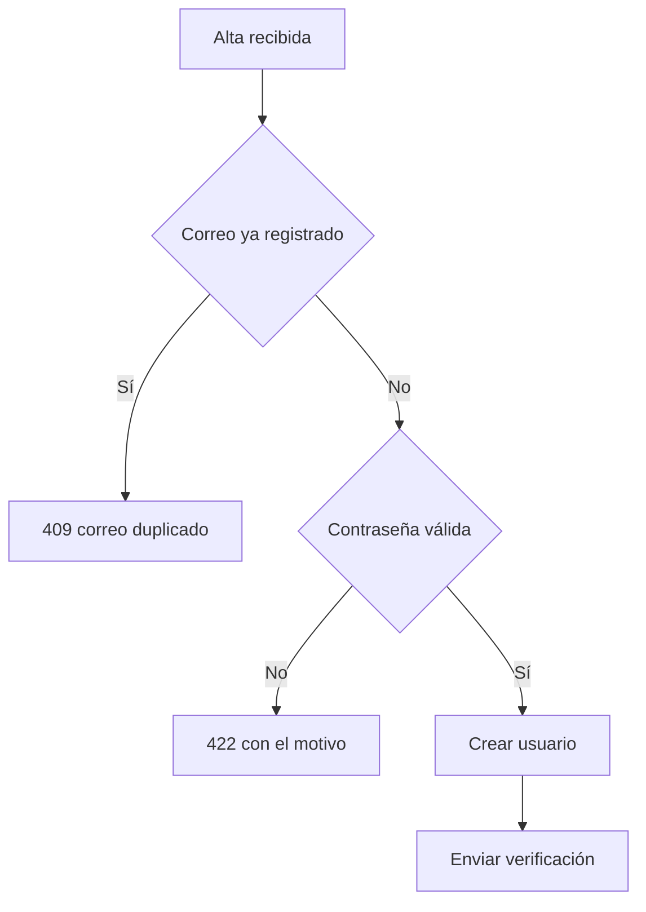

# Diagramas (cuándo dibujar, cuánto y en qué formato)

Un diagrama que acierta ahorra tres párrafos. Uno que no, cuesta el rato de hacerlo, el rato de
descifrarlo y el descubrimiento, dos meses después, de que ya no dice la verdad. Esta guía
decide las cinco cosas que se fallan siempre: **si se dibuja, para quién, a qué altura, cuánto
puede crecer y en qué formato va según dónde acabe**.

**Cuándo:** al preparar la prueba visual del cuerpo de una PR, al documentar una decisión
técnica en el repo, al explicar un flujo que nadie tiene entero en la cabeza. Y en cuanto te
pilles abriendo una herramienta de dibujo antes de haber escrito la frase que el diagrama
sustituiría.

## El gate de entrada

Una pregunta antes de nada, y con nombres propios:

> **¿Aprendería *esta persona concreta*, que va a usar el diagrama *para esto*, más de él que de
> un párrafo bien escrito o de una tabla de tres columnas?**

Si la respuesta es no, no se dibuja. No es una preferencia estética: un diagrama de más obliga
a leer dos veces lo mismo y no añade nada.

Lo de «persona concreta» y «para esto» no adorna la pregunta: es lo que la hace contestable. El
SEI pone justo eso como primer paso de su método de documentación —las vistas se eligen por el
uso previsto— y describe el final de la documentación que no lo hace: la que se escribe para
cumplir un estándar en vez de para una necesidad real acaba «gather dust on shelves». Cuando no
sabes decir quién lo lee, no es que falte el diagrama; falta saber para qué lo haces.

Casos donde la respuesta es no casi siempre:

| Lo que ibas a dibujar | Lo que toca |
|---|---|
| Una lista de cosas (componentes, pasos, opciones) | Tabla o viñetas |
| Un antes / después | Tabla de dos columnas |
| Un diagrama de una sola caja | Escribe la frase |
| Lo que el texto de al lado ya explica entero | Nada |

Y un gate más, que es el que produce diagramas que mienten: **un diagrama afirma cosas**. Cada
caja y cada flecha es una aseveración sobre cómo funciona el sistema. No dibujes lo que no has
comprobado en el código, con la disciplina de {{guide:evidencia-y-preguntas}}; lo que supongas,
márcalo como supuesto en el pie.

El pie vale para un diagrama de PR. Para una decisión técnica que queda en el repo, no: ahí el
**porqué** necesita sitio propio, no una nota al pie del dibujo. El SEI lo ordena como
*how-what-why* —cómo se organiza la documentación, qué es la arquitectura y por qué es así— y
ese «por qué» es el *design rationale*. Un diagrama enseña la decisión tomada; nunca enseña las
que se descartaron ni por qué. Eso se escribe al lado, y también en `progress.md` según
{{guide:registro-progreso}}.

## Presupuesto de complejidad

Por diagrama:

| Límite | Máximo |
|---|---|
| Nodos | 9 |
| Flechas o transiciones | 12 |
| Elementos destacados | 2 |

Si te pasas, **no aprietas el diagrama: lo partes en dos** — uno de visión general y otro de
detalle. Encoger la letra, juntar cajas o cruzar flechas para que quepa todo no es resolver el
problema; es esconderlo.

El motivo del techo: lo único que justifica dibujar es que **se lea de un vistazo**. Por encima
de ese tamaño deja de leerse de un vistazo, y entonces el diagrama ya no gana nada frente al
párrafo que sustituía. El presupuesto no es una regla de estilo, es el punto donde el diagrama
deja de ser rentable.

Lo mismo con los dos elementos destacados. Destacar es decir «mira esto primero». Si destacas
seis, no has decidido cuál importa y el lector se queda igual.

## Declara antes de dibujar

Antes de gastar el esfuerzo, una línea: **para quién, a qué altura, qué tipo y qué dejas fuera
por el presupuesto**.

> «Para quien revise la PR, a altura de componentes: un `flowchart` del alta con los dos desvíos
> de validación. Boceto, no lo mantendrá nadie. Dejo fuera el desglose del envío del correo y
> los reintentos, que no caben.»

Y espera. Si el usuario está delante, deja que te redirija: corregir esa frase cuesta segundos
y rehacer el diagrama no. Si no está, dibuja y anota al lado lo que asumiste y lo que recortaste
— eso va también a `progress.md` según {{guide:registro-progreso}}, porque «esto no está
dibujado» es información que se pierde entera si no se escribe. Sáltate la pausa solo cuando la
petición ya fije tipo y contenido.

## Boceto o artefacto mantenido

Antes del formato, el modo. Fowler separa dos maneras de dibujar y la distinción explica por qué
la tabla de canal es como es.

El **boceto** es selectivo por definición —«the essence of sketching is selectivity»—, se hace
con herramienta ligera, comunica una idea concreta y **se tira**. El **artefacto mantenido**
busca completitud, pide herramienta seria y contrae una deuda: alguien tendrá que actualizarlo
cada vez que el sistema cambie. Su frase para quien se pasa de completo sirve de techo a esta
guía entera: **«comprehensiveness is the enemy of comprehensibility»**.

Declara cuál de los dos haces, porque decide qué pasa después:

- **Boceto** — tiene permiso para envejecer. Ponle la fecha y sigue. Nadie lo va a mantener y
  está bien, siempre que no pretenda ser la verdad presente dentro de seis meses.
- **Artefacto mantenido** — alguien se compromete a actualizarlo, y ese compromiso se escribe
  donde el diagrama vive. Si no puedes nombrar a quién, no lo hagas artefacto: hazlo boceto
  fechado, o no lo hagas.

Casi todo lo que sale de una PR es boceto. Decirlo en voz alta evita la deuda silenciosa de
mantener algo que nadie prometió mantener.

## Regla de canal

El formato no lo eliges tú: lo elige **dónde va a acabar el diagrama**. Un SVG impecable que el
destino no pinta es un hueco en blanco. Es la regla que más se incumple y la que más cara sale,
porque el fallo no se ve hasta que lo lee otro.

| Destino | Formato |
|---|---|
| Cuerpo de PR, comentario de PR, fichero `.md` del repo | **Mermaid** en bloque cercado |
| Comentario de ClickUp | Captura **PNG** adjunta a la tarea y enlazada desde el comentario |
| Material de cliente, diapositivas, documentación publicada fuera de GitHub | **HTML/SVG** del plugin `diagram-design`, exportado a PNG si el destino no renderiza HTML |
| Explicación efímera en la conversación | **Texto**. No se dibuja |

Los motivos, que son lo que hace que la tabla no se te olvide:

- **GitHub renderiza Mermaid de forma nativa** en cuerpos de PR, comentarios y ficheros `.md`
  del repo.
- **GitHub sanea el HTML contra una lista blanca.** ``, `<picture>`, `<details>` y
  `<table>` sobreviven; **el `<svg>` inline se elimina entero** y deja el hueco. Un diagrama SVG
  solo se ve si está **commiteado en el repo**.
- **Y la ruta relativa no vale en todas partes.** `` solo se
  reescribe en ficheros `.md` del repo. En cuerpos de PR, issues y comentarios, GitHub deja el
  `src` tal cual, el navegador lo resuelve contra la URL de la página y sale 404: ahí toca
  `../blob/main/ruta/al/diagrama.svg?raw=true` o la URL absoluta de `raw.githubusercontent.com`.
- **ClickUp no renderiza ni HTML ni Mermaid.** Un bloque cercado se queda ahí como texto
  monoespaciado que nadie lee. Adjunta la captura a la tarea y enlázala desde el comentario.
- **En la conversación no se dibuja.** Una respuesta que se lee y se olvida no necesita
  acompañamiento visual; ese diagrama es trabajo que se tira en el mismo mensaje.

### `diagram-design` es opcional — detecta antes de prometerlo

Es un plugin **aparte** y **no es dependencia de este**. Antes de ofrecer HTML/SVG, comprueba
que lo tienes: `diagram-design` debe aparecer entre tus skills disponibles. Si no está:

1. **Degrada.** El canal de cliente y diapositivas baja a Mermaid, que sigue siendo mejor que
   nada, y lo dices en el entregable. El de ClickUp se queda sin PNG que producir: ahí baja a
   prosa o tabla en el comentario, con enlace a la PR donde el Mermaid sí se ve. No prometas un
   formato que no puedes producir.
2. **Informa de cómo instalarlo**, una vez y sin insistir:

   ```
   /plugin marketplace add https://github.com/cathrynlavery/diagram-design.git
   /plugin install diagram-design@diagram-design
   ```

   Usa la URL HTTPS: con el atajo `owner/repo`, Claude Code tiende a clonar por SSH y falla si
   no está la host key de GitHub en `known_hosts`. Si aun así clona por SSH, el propio error
   dicta el remedio — `ssh -T git@github.com` una vez, para registrar la host key.

Para **exportar a PNG** hace falta además `pip install playwright` y
`python -m playwright install chromium`. El export a SVG no lo necesita. Si vas a adjuntar una
captura a ClickUp y Playwright no está, dilo antes de empezar a dibujar, no después.

Y si el SVG acaba commiteado y mirado en GitHub, exporta PNG igualmente: GitHub sirve los
`.svg` con `Content-Security-Policy: default-src 'none'`, que bloquea las fuentes remotas que
el export inyecta. El diagrama se ve; la tipografía, no.

Y antes de dibujar nada para una PR: si el cambio tiene pantalla, la prueba visual son las
capturas que ya produjo {{guide:qa-exploratoria}}, no un diagrama. El diagrama es para lo que
**no tiene pantalla que capturar**.

## A qué altura miras

La forma es lo último que se decide. Antes va la altura, y saltársela es lo que produce el
diagrama que está técnicamente bien y no le sirve a nadie. Las cuatro alturas del modelo C4,
traducidas a lo que aquí se dibuja:

| Altura | Qué entra | Quién lo lee | Dónde aparece en el flujo |
|---|---|---|---|
| **1 · Contexto** | El sistema como una caja, sus usuarios y los sistemas externos | Negocio, cliente, quien acaba de llegar | Material de cliente; el README de un servicio |
| **2 · Contenedores** | Aplicaciones y almacenes de datos por separado, con su tecnología | Desarrollo, infraestructura | Decisión técnica documentada; onboarding |
| **3 · Componentes** | Las piezas dentro de un contenedor y de qué responde cada una | Desarrollo | Lo normal en una PR que toca varias piezas |
| **4 · Código** | Clases, funciones | Quien va a tocar ese fichero | Casi nunca: el código ya está ahí |

No se dibujan las cuatro: se dibuja **la que responde a la pregunta del lector que nombraste en
el gate**. La altura 4 se omite salvo que la pieza sea de verdad enrevesada.

Y «de verdad enrevesada» necesita criterio, porque si no se cuela cualquier cosa: la relación
entre las piezas **está en el código, pero repartida**, y para verla entera hay que abrir cinco
ficheros y acordarse de los cinco a la vez. Una herencia de tres niveles, un agregado cuyas
partes no viven sueltas, un grafo con ciclos. Si se ve abriendo un fichero, no la dibujes: el
lector va a abrir ese fichero igual.

Y hay tres que no son una altura sino otra pregunta:

| Si lo que muestras es… | |
|---|---|
| Cómo colaboran las piezas **en tiempo de ejecución** para un caso de uso concreto | **Dinámica** — el recorrido, no la estructura |
| Sobre qué infraestructura corre cada pieza | **Despliegue** |
| Varios sistemas de la organización y cómo se tocan entre ellos | **Panorama** |

El fallo más común, y el más difícil de ver desde dentro, es **mezclar alturas**: una caja que
es un sistema entero al lado de otra que es una función. Si te pasa, no es un problema de
dibujo; es que no habías decidido desde dónde mirabas.

## Qué tipo para qué

Con el lector y la altura decididos, la forma casi se elige sola. Va en las dos notaciones que
usamos, porque **el tipo no depende de la herramienta**: C4 es deliberadamente independiente de
la notación, y su autor lo resume en que un conjunto común de abstracciones importa más que una
notación común.

| Lo que muestras | Altura | Mermaid | `diagram-design` |
|---|---|---|---|
| Flujo de decisión con ramas | 3 | `flowchart` | Flowchart |
| Paso a paso de un proceso, con tramos que pasan a la vez | Dinámica | `flowchart` con las ramas paralelas etiquetadas | Flowchart |
| Intercambio ordenado entre actores (petición, respuesta, orden en el tiempo) | Dinámica | `sequenceDiagram` | Sequence |
| Ciclo de vida de una entidad, con esperas y estados terminales | Dinámica | `stateDiagram-v2` | State machine |
| Proceso con traspasos entre responsables | Dinámica | `swimlane-beta` (pide la 11.16.0), o `flowchart` con un `subgraph` por responsable | **Swimlane** |
| Qué piezas hay dentro de un contenedor y qué expone cada una | 3 | `flowchart` con una caja por pieza | Architecture |
| Quién llama a quién, con ciclos y fan-in | 3 | `flowchart` | **Dependency graph** |
| El sistema y su entorno | 1 | `flowchart` con la caja y sus vecinos | Architecture |
| Qué puede hacer cada actor con el sistema | 1 | `usecase-beta`, que GitHub no pinta — lee el apartado siguiente | no tiene tipo |
| Piezas desplegables y su tecnología | 2 | `flowchart` con la tecnología en cada caja | Architecture o Deployment |
| Clases con su herencia y su composición | 4 | `classDiagram` | **UML class** |
| Un caso concreto: qué instancias hay y cómo se apuntan | 4 | no tiene tipo: `flowchart`, una caja por instancia | no tiene tipo |

Las filas en negrita son donde `diagram-design` tiene el tipo exacto: si está instalado, sale
mejor pedírselo por su nombre que describirle un `flowchart`. De las tres, en Mermaid solo hay
que apañar una —el grafo de dependencias, con un `flowchart`—: las clases tienen `classDiagram`
y los traspasos entre responsables, `swimlane-beta` desde la 11.16.0.

Dos filas que antes iban juntas y son preguntas distintas: **qué piezas hay** y qué expone cada
una es el mapa; **quién llama a quién** es el grafo de dependencias. Si las mezclas sale un
diagrama que no contesta ninguna de las dos.

Para las dependencias entre módulos, las fronteras que dibujas son las de {{guide:arquitectura}}:
si el diagrama enseña una flecha que se salta una capa, eso no es un detalle del dibujo, es un
hallazgo.

El caso más frecuente —flujo de decisión— entero y dentro de presupuesto (7 nodos, 6 flechas):



Fíjate en lo que no está: el envío del correo no se desglosa, los reintentos no aparecen y no
hay una caja por cada capa del código. Cabe de un vistazo porque se dejó fuera lo que no
decidía nada.

### Clases, objetos y casos de uso: cuándo sí

Son los tres que más se dibujan por inercia —salen en cualquier curso de UML— y los tres que más
veces sobran. Cada uno tiene su condición, y fuera de ella el diagrama no informa:

- **Clases.** Cuando la relación cumple el criterio de altura 4 de arriba: está en el código,
  pero repartida. No para retratar un fichero que el lector va a abrir igualmente.
- **Objetos.** Cuando el de clases no llega porque lo que confunde es **un caso concreto** —un
  ciclo entre instancias, el árbol real que explica un bug, una configuración que nadie se cree
  hasta verla. Es el más raro de los ocho: si dudas, no es este.
- **Casos de uso.** Cuando hay **varios** actores y sus permisos se solapan, que es justo lo que
  una lista de historias no enseña de un vistazo. Con un actor gana {{guide:historias-usuario}}:
  la tabla de historias dice más y no hay que mantener lo mismo en dos sitios.

### Lo que Mermaid no dibuja, y lo que dibuja pero GitHub no pinta

Son dos huecos distintos y confundirlos cuesta lo mismo: un bloque en crudo en mitad de la PR.

**Uno.** De los ocho tipos UML clásicos, Mermaid tiene cuatro de pleno derecho: clases,
secuencia, máquina de estados y casos de uso. **Objetos y actividades no existen, en ninguna
forma.** Componentes y despliegue solo viven dentro del tipo `c4` —`C4Component` y
`C4Deployment`—, que es notación C4 y no UML, va marcado experimental y tiene sin terminar los
sprites, las etiquetas y la leyenda. Esos cuatro se apañan con `flowchart`, y la tabla de arriba
dice cómo. Si escribes `objectDiagram`, `componentDiagram` o `activityDiagram`, no es que no
renderice: es que te lo has inventado.

**Dos: un tipo marcado `-beta` puede pedir más versión de la que tiene el destino.** GitHub va
por detrás de Mermaid, pero la distancia cambia y hay que medirla, no suponerla: estuvo años
descolgado —servía la 10.0.2 en enero de 2024, cuando Mermaid publicaba la 10.6.1— y hoy va al
día, con la **11.16.1** en agosto de 2026, una versión por detrás de la vigente. Con esos
números, `swimlane-beta` pide la 11.16.0 y **sí se pinta**; `usecase-beta` pide la 12.0.0 y
**no**.

Lo que caduca de este párrafo son las versiones, no la regla: antes de apoyarte en un tipo
reciente, mira qué tiene el destino.

Y no te creas esta guía, que cuesta diez segundos comprobarlo. Un bloque `mermaid` con `info`
dentro pinta la versión desplegada. No sale en la documentación de Mermaid —vive en el código,
`diagrams/info/infoRenderer.ts`, y lo único que dibuja es `v<versión>`—, pero funciona en
cualquier destino que renderice Mermaid.

```mermaid
info
```

Si esa versión no llega a la que pide el tipo que querías, baja a `flowchart` y dilo en el
entregable. Es la misma degradación que manda la regla de canal cuando falta `diagram-design`:
no prometas un formato que el destino no va a pintar.

## Anti-patrones

- **Diagrama que repite el texto de al lado** — si el párrafo ya lo cuenta, el diagrama no
  informa: obliga a leer dos veces. Borra uno de los dos.
- **El sistema entero para una PR de tres ficheros** — el diagrama cubre lo que el cambio toca,
  no el mapa completo del repo. Dibujar de más entierra lo que querías enseñar.
- **El catálogo UML entero** — los ocho tipos porque la lista existe, no porque alguien tuviera
  ocho preguntas. Cada diagrama pasa el gate por su cuenta; los que no lo pasan no se dibujan más
  pequeños, se quedan sin dibujar.
- **Imagen pegada sin texto alternativo ni pie** — sin `alt` no existe para quien usa lector de
  pantalla, que es el criterio WCAG de {{guide:usabilidad-accesibilidad}}; y sin pie nadie sabe
  qué mira ni de cuándo es.
- **El diagrama que nadie actualiza** — dibujado en la PR, correcto ese día y mentiroso a los
  dos meses. El remedio no es dibujarlo mejor: es haber declarado el modo. Si es boceto, lleva
  fecha y nadie espera que esté al día; si lo diste por artefacto mantenido, alguien tiene que
  estar nombrado. Y si describe algo que cambia cada semana, no lo dibujes.
- **Cajas de dos alturas distintas en el mismo dibujo** — un sistema entero al lado de una
  función. El lector no puede saber a qué escala está mirando, y las flechas entre ambas no
  significan nada comparable.
- **Diagrama sin título ni leyenda** — sin un título que diga tipo y alcance, nadie sabe qué
  mira; sin leyenda, adivina qué querían decir tus colores y tus líneas de puntos. Los dos se
  arreglan en treinta segundos y son los que más se olvidan.
- **Flechas mudas** — una flecha pelada, o etiquetada «usa». La flecha es la mitad de la
  información: dice qué hace una pieza con la otra, en qué dirección y, entre procesos, por qué
  protocolo.
- **Seis cosas destacadas** — destacar todo es no destacar nada. Dos como mucho; si no sabes
  cuáles, es que aún no has decidido qué cuenta el diagrama. Y que el destacado no viva solo en
  el color: en blanco y negro, o para quien no distingue esos dos tonos, desaparece entero.
- **Formato elegido por comodidad** — el SVG bonito en un comentario de GitHub y el bloque
  Mermaid en ClickUp son el mismo error: se eligió el formato sin mirar el destino.

## Autocrítica antes de entregar

El test que más recorta, y el único que no admite autoengaño:

> **¿Se sostiene solo?** — *«whether each diagram can stand alone, and be (mostly) understood
> without a narrative»*.

Si para entenderlo hace falta que tú estés delante explicándolo, no está terminado. Quien lo
abra dentro de seis meses no te va a tener al lado.

Luego la lista. Las cuatro primeras son las que más se fallan:

- **¿Tiene título que diga el tipo y el alcance?** No «Arquitectura», sino «Alta de usuario —
  componentes del servicio de cuentas».
- **¿Tiene leyenda?** Si formas, colores, bordes o tipos de línea significan algo, hay que decir
  qué. También cuando la notación te parece estándar: no todo el mundo la conoce.
- **¿Cada flecha dice qué hace, y en la dirección correcta?** Una palabra vaga como «usa» no
  cuenta. Entre procesos, además, la tecnología o el protocolo.
- **¿El significado viaja solo en el color?** Entonces no llega. Que lo lleve también la forma,
  la posición o el texto — por impresión en blanco y negro, por daltonismo, y porque es el
  criterio WCAG de {{guide:usabilidad-accesibilidad}}.
- ¿Una tabla o un párrafo harían el mismo trabajo?
- ¿Estoy dentro de 9 nodos, 12 flechas y 2 destacados?
- ¿Dije antes de dibujar para quién, a qué altura, qué tipo y qué dejaba fuera?
- ¿Todas las cajas están a la misma altura?
- ¿El formato es el que renderiza el destino real, y el modo el que declaré?
- ¿Cada caja y cada flecha las he comprobado en el código?
- ¿Lleva texto alternativo y pie?

Si algo falla, corrígelo antes de entregar — o borra el diagrama, que muchas veces es la
respuesta.

---

Las alturas, el test de autosuficiencia y buena parte de la lista de arriba están adaptados del
[modelo C4](https://c4model.com) de Simon Brown, bajo licencia CC BY 4.0. Los dos modos de
dibujar vienen de [Martin Fowler](https://martinfowler.com/bliki/UmlMode.html), y el criterio de
elegir por uso previsto e interesado, del enfoque *Views and Beyond* del SEI.

Los tipos que tiene Mermaid y las versiones que piden se comprobaron el **2026-09-28** contra
[su referencia de sintaxis](https://mermaid.js.org/intro/syntax-reference.html) y contra el
árbol `packages/mermaid/src/diagrams` del repositorio; la versión que sirve GitHub, contra el
[hilo donde se mide](https://github.com/orgs/community/discussions/70672). Es lo que antes
caduca de esta guía, así que el bloque `info` de arriba manda sobre lo que digan estos párrafos.
